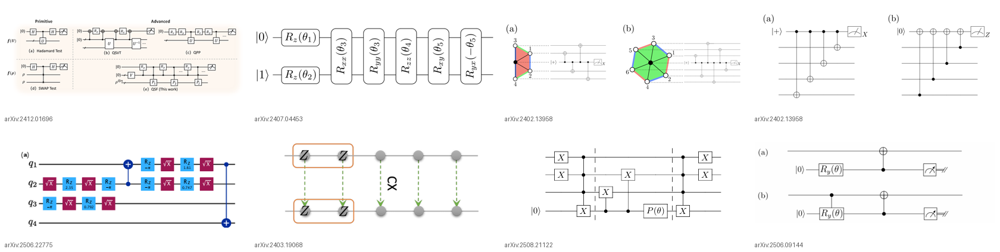
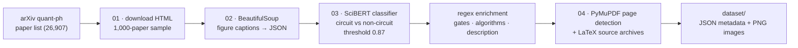
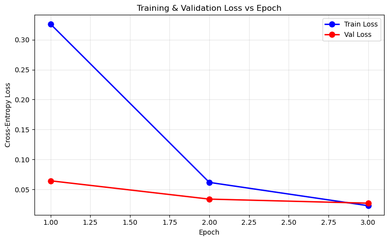
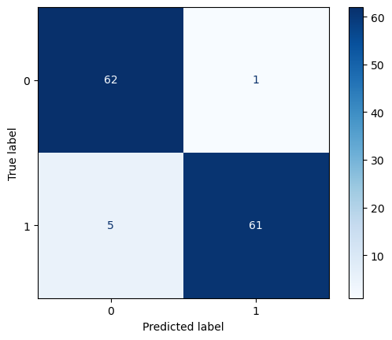

<div align="center">

# QuantumCircuit Dataset Builder: Automated Image-to-Text Pipeline

**An automated pipeline that mines arXiv `quant-ph` papers for quantum-circuit figures and pairs each one with
structured metadata (gates, algorithm, description, page, text positions). The result is a prototype dataset for
fine-tuning image-to-text models on technical diagrams.**

[](#setup)
[](#2-caption-classifier-scibert)
[](#pipeline)
[](LICENSE)

[📄 Report (PDF)](docs/report.pdf) · [🗂️ Dataset](dataset) · [⚙️ Pipeline](pipeline)

*Natural Language Processing and Information Retrieval · M.Sc. Artificial Intelligence for Industrial Applications ·
OTH Amberg-Weiden · Winter Semester 2025/26*

</div>

---

<p align="center"></p>

## TL;DR

| | |
|---|---|
| **Problem** | Image-to-text models trained on natural photos (COCO and similar) cannot describe technical schematics such as quantum circuits, because no suitable training data exists. |
| **Approach** | Download arXiv HTML → extract figure captions with BeautifulSoup → classify captions as *quantum circuit* or not with fine-tuned **SciBERT** → fill in metadata with regex → recover the original image files from the arXiv LaTeX source archives. |
| **Classifier** | SciBERT, test **accuracy 0.954, weighted F1 0.954** (129 held-out captions) |
| **Output** | **250** metadata records from 129 papers, and **160** extracted circuit images from 81 papers |

## Pipeline



### Why HTML? Three approaches were tried

| | PDF heuristics (PyMuPDF) | LaTeX source parsing | **HTML + source archive (final)** |
|---|---|---|---|
| Image extraction | ❌ mix of raster and vector graphics, so crops are incomplete | ✅ original files are in the archive | ✅ taken from the archive |
| Caption ↔ figure link | hard | direct, but hard to parse | **direct, clean BeautifulSoup parsing** |
| Verdict | dropped | used only to locate image files | **chosen** |

### 1. Caption extraction (`pipeline/02_html_figure_extractor.py`)
- Parses every `<figure>` in the arXiv HTML and records the arXiv ID, figure number and the cleaned raw caption.
- **Description** = the first sentence of the caption. Authors usually summarise the figure there; a manual check
  found this correct in more than 85 % of cases.
- **Gates** are found with regex patterns for more than 50 gates and their synonyms: X/Y/Z/H, S/T, RX/RY/RZ,
  CNOT/CZ/Toffoli, iSWAP, MS and others.
- **Algorithms** are found with regex patterns for more than 40 algorithms: Shor, Grover, QFT, VQE, QAOA, quantum
  machine learning methods and others. If a caption mentions none, the field is set to `"not specifically mentioned"`.

### 2. Caption classifier (SciBERT)
- **Data:** 257 captions labelled by hand from about 600 papers (125 circuit, 132 non-circuit). Synthetic
  augmentation expanded them to **1,285 captions** (657 / 628), stored in
  [`pipeline/1285-Data.csv`](pipeline/1285-Data.csv).
- **Model:** `allenai/scibert_scivocab_uncased`. AdamW with learning rate 2e-5, 3 epochs, linear warm-up.
  Split: 1,028 train / 128 validation / 129 test.
- **Decision rule:** a figure counts as a circuit only if *P(circuit) ≥ 0.87*. Circuits are rare (about one per
  five papers), so the threshold favours precision.

| Metric (test set, 129) | Value |
|---|:---:|
| Accuracy | **0.954** |
| Precision (weighted) | 0.955 |
| Recall (weighted) | 0.954 |
| F1 (weighted) | **0.954** |
| Circuit-class precision / recall | 0.984 / 0.924 |

<p align="center">
  
  
</p>

> The test split is drawn from the *augmented* caption set, so it is easier than real arXiv captions. On real
> captions the report estimates about 75–85 % classification accuracy, and about 73 % for the pipeline overall.

### 3. Page numbers and image retrieval (`pipeline/04_image_retrieval_pipeline.ipynb`)
1. **Page numbers:** PyMuPDF finds the caption block for each figure in the paper's PDF.
2. **Image files:**
   1. Download each paper's LaTeX source archive and convert its `.tex` files to text.
   2. Find the `\includegraphics{…}` names inside the matching figure environment.
   3. Copy those images out of the archive. PDF figures are converted to PNG.
3. **Missing images:** some figures could not be recovered, because the LaTeX had no file reference or the archive
   used unusual file names. That is why there are **160 images for 250 metadata records**.

## Dataset

See [`dataset/README.md`](dataset/README.md) for the full card. Each record looks like this:

```json
{
  "2310.10451_fig_3": {
    "arxiv_number": "2310.10451",
    "page_number": 10,
    "figure_number": 3,
    "quantum_gates": "not specifically mentioned",
    "quantum_problem": ["Quantum walk"],
    "description": "Circuit of one step of the quantum walk for the path graph u − v − w .",
    "text_positions": [[62088, 62158]]
  }
}
```

| Statistic | Value |
|---|:---:|
| Metadata records / papers | 250 / 129 |
| Extracted images (PNG) / papers | 160 / 81 |
| Records with a page number | 250 (100 %) |
| Records with at least one gate | 74 (30 %) |
| Records with an algorithm or problem | 53 (21 %) |
| Most common gates | CNOT (25), H (19), RY (11), X (10), CZ (7) |
| Most common problems | Ansatz (19), state preparation (9), VQC (8), Bell state (7), Trotter (5) |

## Repository structure

```
.
├── pipeline/                              # run all steps from this folder (shared working directory)
│   ├── 01_download_arxiv_html.py          # arXiv HTML downloader (resumable, 2–4 s polite delay)
│   ├── 02_html_figure_extractor.py        # captions → per-figure JSON (gates, algorithms, description)
│   ├── 03_caption_classifier_scibert.ipynb  # train SciBERT, then filter the JSONs to circuits
│   ├── 04_image_retrieval_pipeline.ipynb  # page numbers, LaTeX sources, image extraction
│   └── 1285-Data.csv                      # labelled and augmented captions for training
├── dataset/
│   ├── metadata/<paper>/<id>_fig_<n>.json # 250 records
│   ├── images/<paper>/<file>.png          # 160 circuit images
│   ├── paper_list_count_45.csv            # circuits found per paper in the assigned list
│   └── README.md                          # dataset card
├── docs/
│   ├── report.pdf
│   └── figures/
├── requirements.txt
├── CITATION.cff
└── LICENSE
```

## Setup

```bash
git clone https://github.com/SomanthaManuranga/QuantumCircuit-Dataset-Builder-Automated-Image-to-Text-Pipeline.git
cd QuantumCircuit-Dataset-Builder-Automated-Image-to-Text-Pipeline
python -m venv .venv && source .venv/bin/activate   # Windows: .venv\Scripts\activate
pip install -r requirements.txt
```

## Running the pipeline

Run each step from inside `pipeline/`. Each step writes the folder that the next step reads.

```bash
cd pipeline
```

1. Put one arXiv ID per line in `Sample_papers.csv`, then download the HTML versions (written to `downloaded_html/`):

   ```bash
   python 01_download_arxiv_html.py
   ```

2. Extract the captions and metadata from the HTML files (written to `Figure_JSON/`):

   ```bash
   python 02_html_figure_extractor.py
   ```

3. Open `03_caption_classifier_scibert.ipynb`. It trains the classifier on `1285-Data.csv`, saves it to
   `Quantum_circuit_figure_caption_Classifier/`, and filters `Figure_JSON/` into `Filtered_Quantum_Circuit_Figures/`.
   A GPU is recommended; training took about 15 minutes.
4. Open `04_image_retrieval_pipeline.ipynb`. It detects page numbers, downloads the LaTeX source archives and
   extracts the figure images.

The intermediate folders, model weights and downloaded papers are git-ignored. Please keep the request delay:
arXiv rate-limits automated downloads.

## Limitations

- **Captions are an indirect signal.** A figure is classified from its text only, never from its pixels, so
  circuits described vaguely in their captions are missed.
- **The classifier was evaluated on augmented data,** which overstates real-world accuracy (see above).
- **The gate and algorithm lists are rule-based.** New or unusually named gates and algorithms are not detected, and
  most records say `"not specifically mentioned"`.
- **Image recovery is incomplete** (160 of 250), because arXiv source archives are inconsistent.
- **arXiv HTML** is not available for every paper.

**Possible next steps:** a multimodal model that reasons over the caption and the image together, more
hand-labelled captions, and figure-level checking of recovered images.

## References

1. C. Clark and S. Divvala, *PDFFigures 2.0: Mining Figures from Research Papers*, JCDL 2016.
2. I. Beltagy, K. Lo and A. Cohan, *SciBERT: A Pretrained Language Model for Scientific Text*, EMNLP 2019.
3. M. Mathew, D. Karatzas and C. V. Jawahar, *DocVQA: A Dataset for VQA on Document Images*, WACV 2021.
4. K. V. Jobin, A. Mondal and C. V. Jawahar, *DocFigure: A Dataset for Scientific Document Figure Classification*, ICDAR-W 2019.

## License

- **Code:** [MIT](LICENSE).
- **Dataset:** the images and caption text are taken from arXiv papers and remain the copyright of their authors.
  Every record names its source paper by arXiv ID. They are shared here for non-commercial research and teaching;
  cite the original papers when you use them.
